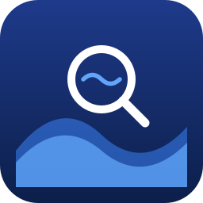
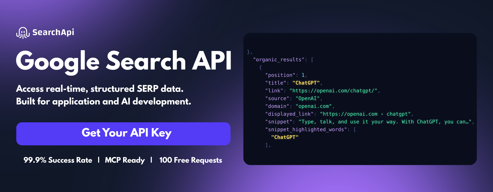
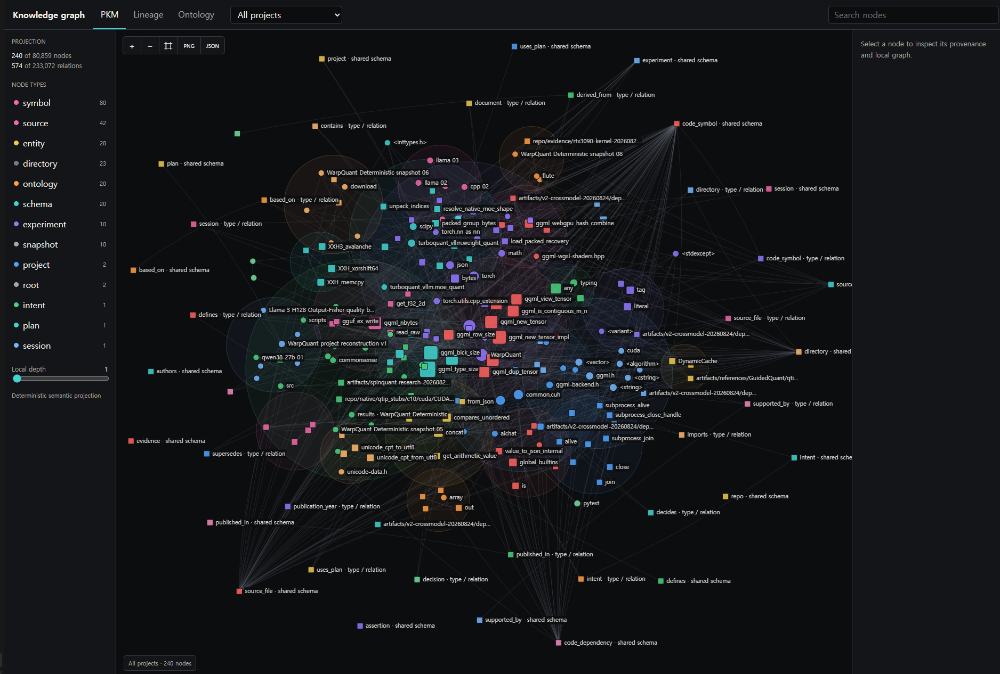

# google-surf-mcp

[English](./README.md) | 한국어

Google Surf MCP는 웹·논문·코드베이스를 검색하고, 읽은 자료를 Auto Ontology로 로컬 지식그래프에 정리합니다.
API 키나 별도 DB 서버 없이 시작하고, 자료와 프로젝트 기록을 연결해 나만의 지식체계를 쌓아갑니다.

[](https://www.npmjs.com/package/google-surf-mcp)
[](https://www.npmjs.com/package/google-surf-mcp)
[](https://github.com/HarimxChoi/google-surf-mcp/actions/workflows/ci.yml)
[](https://mcptoplist.com/server/io.github.HarimxChoi%2Fgoogle-surf-mcp)
[](https://glama.ai/mcp/servers/HarimxChoi/google-surf-mcp)

<p align="center">
  <a href="https://www.searchapi.io/?utm_source=github&utm_medium=sponsorship&utm_campaign=google_search_api&utm_content=HarimxChoi_google-surf-mcp"></a>
</p>
<p align="center"><a href="https://www.searchapi.io/?utm_source=github&utm_medium=sponsorship&utm_campaign=google_search_api&utm_content=HarimxChoi_google-surf-mcp">SearchApi</a> 후원</p>

<a href="./assets/graph-pkm.png"></a>

## 핵심 기능

- **검색과 읽기:** 웹페이지·논문·PDF·GitHub 저장소·색인된 로컬 코드를 검색합니다. Tree-sitter로 파일·코드 심벌·import·함수 호출 관계를 연결합니다.
- **Auto Ontology:** 자료와 프로젝트 기록을 근거와 데이터 리니지를 갖춘 지식그래프로 구조화합니다.
- **프로젝트 통합 검색:** 선택한 프로젝트에 쌓인 자료를 정확 일치·키워드·의미·그래프 검색으로 찾고, RRF와 공통 리랭커로 결과 순위를 정합니다.
- **탐색과 내보내기:** PKM·리니지·온톨로지를 탐색하고 HTML·PNG·JSON·Graphviz DOT 파일과 Neo4j 가져오기용 파일로 내보냅니다.

**Stack:** TypeScript, Chrome/Playwright, LiteParse, Tree-sitter, SurrealDB, Multilingual E5, Graphology. [구조 설명](./guides/auto-ontology.md)

## 빠른 시작

Node.js 22.12+가 필요하며, 브라우저 검색에는 Chrome 또는 Chromium도 필요합니다. CI에서 Linux·Windows의 Node 22·24 환경을 테스트합니다.

MCP 클라이언트 설정에 서버를 등록합니다.

```json
{
  "mcpServers": {
    "google-surf": {
      "command": "npx",
      "args": ["-y", "google-surf-mcp@latest"]
    }
  }
}
```

클라이언트를 재시작합니다. Auto Ontology는 기본으로 켜져 있으며, 처음 색인할 때 필요한 로컬 임베딩 모델을 내려받을 수 있습니다.
DB나 임베딩 모델 없이 검색·추출만 사용하려면 서버 환경변수에 `SURF_RESEARCH=false`를 설정합니다.

[클라이언트 설정·로컬 설치·SearchApi 설정](./guides/getting-started.md)

## 검색

- API 키가 필요 없는 시스템 Chrome 검색
- 사용자 Chrome 프로필을 읽거나 복사하지 않는 전용 비로그인 프로필
- 여러 파서와 화면 배치 검증을 통한 검색 결과 추출
- 광고와 지식 패널 제거
- CAPTCHA 감지와 환경별 복구
- 파서 자동 복구와 브라우저 컨텍스트 전환

브라우저 검색이 기본입니다. [SearchApi](https://www.searchapi.io/?utm_source=github&utm_medium=sponsorship&utm_campaign=google_search_api&utm_content=HarimxChoi_google-surf-mcp)를 기본 검색 또는 대체 검색으로 설정할 수도 있으며, 별도 계정·키·크레딧이 필요합니다.

## Supported AI providers and gateways

- [OrcaRouter](https://www.orcarouter.ai/ref/ref_7fd137d6c7b30793af2f) (free models available)

[선택 사항: LLM 기반 복구·OrcaRouter 설정](./guides/configuration.md#orcarouter)

## Tools

Auto Ontology가 켜져 있으면 도구 7개를 사용할 수 있습니다.

| 도구 | 역할 |
| --- | --- |
| `search` / `search_parallel` | **새 웹 자료**를 찾고, 같은 호출에서 `extract_mode`로 본문을 읽습니다. |
| `scholar_search` | Google Scholar에서 논문 메타데이터를 검색합니다. |
| `extract` | **이미 알고 있는 URL**에서 웹페이지·PDF·저장소 내용을 읽습니다. |
| `project_memory_search` | 저장된 프로젝트 지식을 **로컬에서만** 검색합니다. 라이브 웹 검색은 하지 않습니다. |
| `project_memory` | 프로젝트 관리, 연구 기록 저장, 사용자가 허용한 로컬 폴더 색인, 그래프 내보내기를 수행합니다. |
| `health` | 검색 및 로컬 서비스의 상태를 확인합니다. |

웹 검색에 `project_id`를 넣어도 로컬 전용 검색이 되지는 않습니다. 저장된 자료는 `project_memory_search`로 조회합니다.

[도구 인자·사용 제한·추가 본문 읽기·반복 가능한 자료 수집](./guides/tools.md)

## Google Surf Auto Ontology

검색·추출 결과는 자동 저장됩니다. 계획·실험·실패·결정은 에이전트가 `project_memory`로 기록하면 연결됩니다.

```text
웹 + 논문 + 코드 + 프로젝트 기록
                  |
          로컬 지식그래프
                  |
       하이브리드 검색 + 원문 근거
```

프로젝트는 기본적으로 분리됩니다. 선택한 프로젝트끼리 일치하는 DOI·저장소 URL이나 명시적으로 등록한 별칭으로 지식을 연결하며, 원본 기록을 합치거나 이동하지 않습니다.

프로젝트 하나의 독립 실행형 그래프 탐색기를 만들 수 있습니다.

```text
project_memory(action="export", project_id="my-project", export_format="html", export_view="graph")
```

HTML에서 PKM·리니지·온톨로지 뷰를 탐색하고 PNG·JSON을 내려받습니다. DOT·Neo4j 내보내기도 지원합니다.
기능명은 Research에서 Auto Ontology로 바뀌었지만 기존 `SURF_RESEARCH*`, `project_memory*`, CLI 이름과 저장 경로는 그대로 사용할 수 있습니다.

[온톨로지·리니지·코드 색인·내보내기 상세](./guides/auto-ontology.md)

## 검증 결과

평가용으로 분리한 검색어 32개로 라이브 웹 검색 결과의 순위를 비교했습니다.

| 순위 방식 | nDCG@5 | MRR | Precision@5 |
| --- | ---: | ---: | ---: |
| 검색 제공자의 원래 순위 | 0.8949 | 0.8203 | 0.6375 |
| BM25 + RRF | **0.8971** | **0.8203** | **0.6500** |

[평가 조건·검색 결과·자원 측정](./guides/benchmarks.md)

## 자세한 문서

| 가이드 | 내용 |
| --- | --- |
| [시작하기](./guides/getting-started.md) | 설치·클라이언트·브라우저·SearchApi 설정 |
| [도구와 워크플로우](./guides/tools.md) | 도구 인자·사용 제한·근거 반환 방식·자료 수집 |
| [Auto Ontology](./guides/auto-ontology.md) | 저장·코드 구조·그래프 검색·리니지·내보내기 |
| [설정](./guides/configuration.md) | 환경변수·자원 사용 설정·OrcaRouter |
| [운영과 보안](./guides/operations.md) | CAPTCHA·캐시 정리·CLI·개인정보·선택형 Codex 출력 보호 훅 |
| [벤치마크](./guides/benchmarks.md) | 측정값·조건·평가 범위 |

[기여 방법](./CONTRIBUTING.md) · [변경 이력](./CHANGELOG.md) · [MIT License](./LICENSE)
