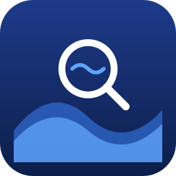
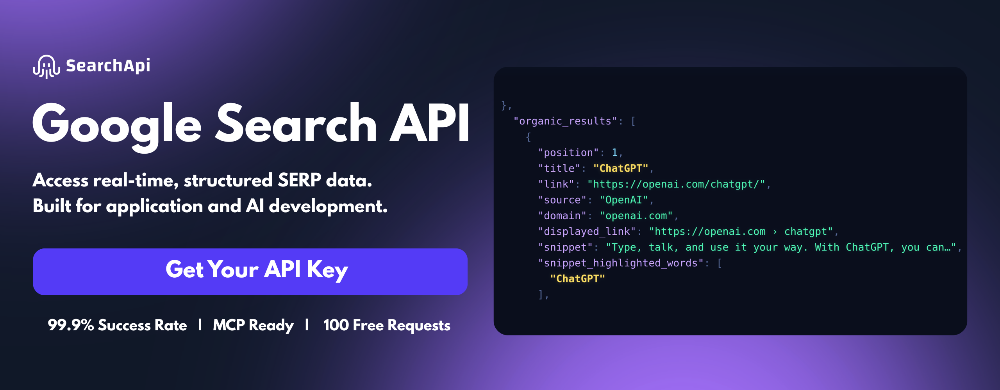
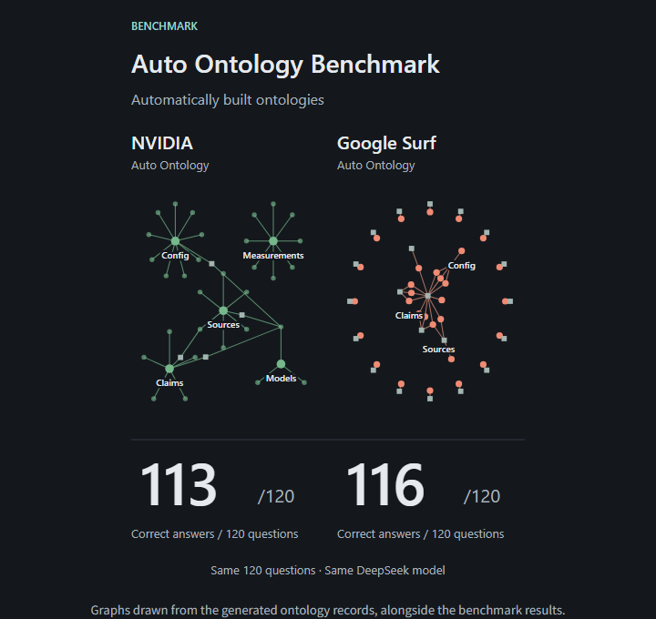
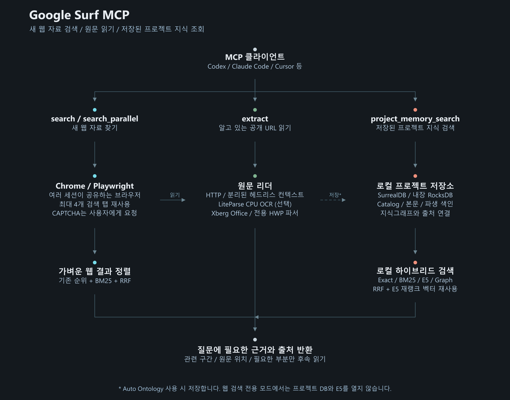
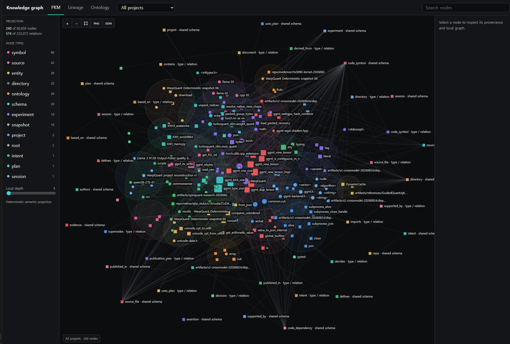

# google-surf-mcp

[English](./README.md) | 한국어

[](https://www.npmjs.com/package/google-surf-mcp)
[](https://www.npmjs.com/package/google-surf-mcp)
[](https://github.com/HarimxChoi/google-surf-mcp/actions/workflows/ci.yml)
[](https://mcptoplist.com/server/io.github.HarimxChoi%2Fgoogle-surf-mcp)
[](https://glama.ai/mcp/servers/HarimxChoi/google-surf-mcp)

<p align="center">
  <a href="https://www.searchapi.io/?utm_source=github&utm_medium=sponsorship&utm_campaign=google_search_api&utm_content=HarimxChoi_google-surf-mcp"></a>
</p>
<p align="center"><a href="https://www.searchapi.io/?utm_source=github&utm_medium=sponsorship&utm_campaign=google_search_api&utm_content=HarimxChoi_google-surf-mcp">SearchApi</a> 후원</p>

[설치](#빠른-시작) · [벤치마크](#검증-결과) · [전체 구조](#전체-구조) · [도구](#tools)

Google Surf MCP는 웹·논문·코드베이스를 검색하고, 읽은 자료를 Auto Ontology로 로컬 지식그래프에 정리합니다.
API 키나 별도 DB 서버 없이 시작하고, 자료와 프로젝트 기록을 연결해 나만의 지식체계를 쌓아갑니다.

## 검증 결과

### 웹 검색·파일 분석: GAIA Level 3

[GAIA](https://arxiv.org/abs/2311.12983)는 AI 에이전트가 웹 검색과 파일 분석을 활용해 여러 단계에 걸쳐 실제 질문에 답할 수 있는지 평가합니다. 레벨 3은 세 단계 중 가장 어렵습니다.

**Google Surf와 DeepSeek V4.1 Flash(`deepseek-flash`)를 연결해 GAIA 레벨 3 공개 검증셋 26문항 중 22문항(84.62%)을 맞혔습니다.** 검색에는 Google Surf를 사용했고, 근거 확인과 최종 제출은 별도 평가 러너에서 처리했습니다.

| 에이전트 | 평가 세트 | 레벨 3 |
| --- | --- | ---: |
| **Google Surf + DeepSeek V4.1 Flash** | [공개 검증셋](https://huggingface.co/datasets/gaia-benchmark/GAIA) | **22/26 (84.62%)** |
| [Alita · Claude Sonnet 4 + GPT-4o](https://arxiv.org/html/2505.20286) | 공개 검증셋, pass@3 | 20/26 (76.92%) |
| [xpander.ai · Claude Opus 4.7 → GPT-5.5 Pro](https://github.com/xpander-ai/xpander-gaia-benchmark-results) | 공개 검증셋, pass@2 | 19/26 (73.08%) |

Surf가 맞힌 문항 중 두 개는 검색 결과에 공개 풀이가 나왔으며, 두 문항 모두 점수에 포함했습니다.

### Auto Ontology 비교

<a href="./assets/auto-ontology-benchmark.png"></a>

오픈웨이트 모델 릴리스 16종의 모델카드·설정 파일 48개로 각각 온톨로지를 구축했습니다. 각 시스템이 찾은 근거를 동일한 DeepSeek V4.1 Flash (1017) 모델(`deepseek-flash`), SQL 생성 프롬프트와 DB에 적용한 결과는 **Google Surf 116/120, NVIDIA Auto Ontology 113/120**이었습니다. 제품의 기본 에이전트끼리 비교한 결과는 아닙니다.

[평가 조건·웹 검색 순위·자원 측정](./guides/benchmarks.md)

## 전체 구조

<a href="./assets/architecture-ko.png"></a>

### 기술 스택

| 영역 | 기술 |
| --- | --- |
| 실행 환경·프로토콜 | TypeScript, Node.js 22.13+, MCP SDK, Zod |
| 브라우저 검색 | 시스템 Chrome, Playwright, 공유 브라우저 브로커와 탭 재사용 |
| 원문 읽기 | HTTP, 분리된 헤드리스 BrowserContext, Mozilla Readability, Turndown |
| 문서·OCR | LiteParse CPU OCR, Office용 선택적 Xberg, OfficeParser 대체 경로, hwp-convert, pdf-lib, Sharp |
| 로컬 저장소 | SurrealDB와 내장 RocksDB, catalog·본문 저장, 재생성 가능한 색인 |
| 검색·정렬 | 정확 일치, BM25, Multilingual E5-small q8/ONNX, HNSW, 그래프 검색, RRF, E5 재랭크 벡터 재사용 |
| 코드 색인 | Python·TypeScript·C++ 구조를 읽는 Tree-sitter |
| 그래프 분석 | Graphology, PageRank, Louvain 커뮤니티, 출처·데이터 리니지 표현 |
| 네트워크 제어 | Undici, DNS·IP 고정 읽기, SSRF 검사, 미승인 요청을 차단하는 원문 리더 프록시 |

OCR은 설정으로 켜며, Xberg에 별도 OCR·임베딩 모델을 붙이지 않습니다. 웹 검색 전용 모드에서는 E5 없이 BM25/RRF를 사용합니다. [구조 상세](./guides/auto-ontology.md) · [경량 설정 예시](./examples/lightweight-documents.env)

## 빠른 시작

Node.js 22.13+가 필요하며, 브라우저 검색에는 Chrome 또는 Chromium도 필요합니다. CI에서 Linux·Windows의 Node 22·24 환경을 테스트합니다.

MCP 클라이언트 설정에 서버를 등록합니다.

```json
{
  "mcpServers": {
    "google-surf": {
      "command": "npx",
      "args": ["-y", "google-surf-mcp@latest"]
    }
  }
}
```

클라이언트를 재시작합니다. Auto Ontology는 기본으로 켜져 있으며, 처음 색인할 때 필요한 로컬 임베딩 모델을 내려받을 수 있습니다.
DB나 임베딩 모델 없이 검색·추출만 사용하려면 서버 환경변수에 `SURF_RESEARCH=false`를 설정합니다.

[클라이언트 설정·로컬 설치·SearchApi 설정](./guides/getting-started.md)

## 검색

- API 키가 필요 없는 시스템 Chrome 검색
- 사용자 Chrome 프로필을 읽거나 복사하지 않는 전용 비로그인 프로필
- 여러 파서와 화면 배치 검증을 통한 검색 결과 추출
- 광고와 지식 패널 제거
- CAPTCHA 감지와 환경별 복구
- 파서 자동 복구와 브라우저 컨텍스트 전환

브라우저 검색이 기본입니다. [SearchApi](https://www.searchapi.io/?utm_source=github&utm_medium=sponsorship&utm_campaign=google_search_api&utm_content=HarimxChoi_google-surf-mcp)를 기본 검색 또는 대체 검색으로 설정할 수도 있으며, 별도 계정·키·크레딧이 필요합니다.

## Supported AI providers and gateways

- [OrcaRouter](https://www.orcarouter.ai/ref/ref_7fd137d6c7b30793af2f) (free models available)

[선택 사항: LLM 기반 복구·OrcaRouter 설정](./guides/configuration.md#orcarouter)

## Tools

Auto Ontology가 켜져 있으면 도구 7개를 사용할 수 있습니다.

| 도구 | 역할 |
| --- | --- |
| `search` / `search_parallel` | **새 웹 자료**를 찾고, 같은 호출에서 `extract_mode`로 본문을 읽습니다. |
| `scholar_search` | Google Scholar에서 논문 메타데이터를 검색합니다. |
| `extract` | **이미 알고 있는 URL**에서 웹페이지·PDF·저장소 내용을 읽습니다. |
| `project_memory_search` | 저장된 프로젝트 지식을 **로컬에서만** 검색합니다. 라이브 웹 검색은 하지 않습니다. |
| `project_memory` | 프로젝트 관리, 연구 기록 저장, 사용자가 허용한 로컬 폴더 색인, 그래프 내보내기를 수행합니다. |
| `health` | 검색 및 로컬 서비스의 상태를 확인합니다. |

웹 검색에 `project_id`를 넣어도 로컬 전용 검색이 되지는 않습니다. 저장된 자료는 `project_memory_search`로 조회합니다.

[도구 인자·사용 제한·추가 본문 읽기·반복 가능한 자료 수집](./guides/tools.md)

## Google Surf Auto Ontology

<a href="./assets/graph-pkm.png"></a>

검색·추출 결과는 자동 저장됩니다. 계획·실험·실패·결정은 에이전트가 `project_memory`로 기록하면 연결됩니다.

선택한 프로젝트에 쌓인 자료를 정확 일치·키워드·의미·그래프 검색으로 찾고, RRF와 공통 리랭커로 결과 순위를 정합니다.

프로젝트는 기본적으로 분리됩니다. 선택한 프로젝트끼리 일치하는 DOI·저장소 URL이나 명시적으로 등록한 별칭으로 지식을 연결하며, 원본 기록을 합치거나 이동하지 않습니다.

프로젝트 하나의 독립 실행형 그래프 탐색기를 만들 수 있습니다.

```text
project_memory(action="export", project_id="my-project", export_format="html", export_view="graph")
```

HTML에서 PKM·리니지·온톨로지 뷰를 탐색하고 PNG·JSON을 내려받습니다. DOT·Neo4j 내보내기도 지원합니다.
기능명은 Research에서 Auto Ontology로 바뀌었지만 기존 `SURF_RESEARCH*`, `project_memory*`, CLI 이름과 저장 경로는 그대로 사용할 수 있습니다.

[온톨로지·리니지·코드 색인·내보내기 상세](./guides/auto-ontology.md)

## 자세한 문서

| 가이드 | 내용 |
| --- | --- |
| [시작하기](./guides/getting-started.md) | 설치·클라이언트·브라우저·SearchApi 설정 |
| [도구와 워크플로우](./guides/tools.md) | 도구 인자·사용 제한·근거 반환 방식·자료 수집 |
| [Auto Ontology](./guides/auto-ontology.md) | 저장·코드 구조·그래프 검색·리니지·내보내기 |
| [설정](./guides/configuration.md) | 환경변수·자원 사용 설정·OrcaRouter |
| [운영과 보안](./guides/operations.md) | CAPTCHA·캐시 정리·CLI·개인정보·선택형 Codex 출력 보호 훅 |
| [벤치마크](./guides/benchmarks.md) | 측정값·조건·평가 범위 |

[기여 방법](./CONTRIBUTING.md) · [변경 이력](./CHANGELOG.md) · [MIT License](./LICENSE)
