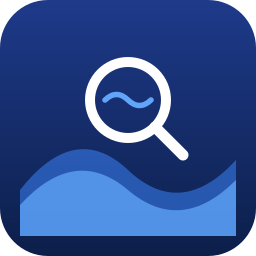
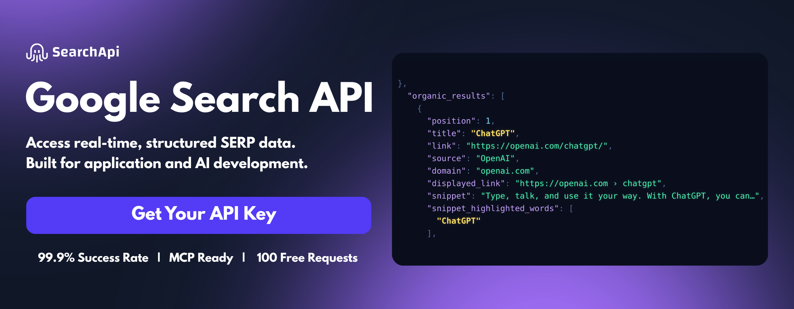
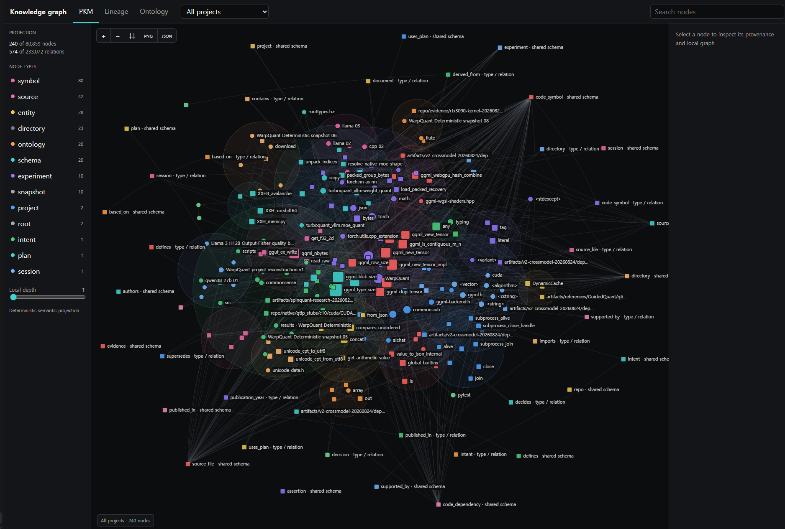

# google-surf-mcp

English | [Korean](./README.ko.md)

Google Surf MCP searches the web, papers, and codebases, then uses Auto Ontology to organize what you read into a local knowledge graph.
Start without an API key or a separate database server, and build a personal knowledge base from connected sources and project records.

[](https://www.npmjs.com/package/google-surf-mcp)
[](https://www.npmjs.com/package/google-surf-mcp)
[](https://github.com/HarimxChoi/google-surf-mcp/actions/workflows/ci.yml)
[](https://mcptoplist.com/server/io.github.HarimxChoi%2Fgoogle-surf-mcp)
[](https://glama.ai/mcp/servers/HarimxChoi/google-surf-mcp)

<p align="center">
  <a href="https://www.searchapi.io/?utm_source=github&utm_medium=sponsorship&utm_campaign=google_search_api&utm_content=HarimxChoi_google-surf-mcp"></a>
</p>
<p align="center">Sponsored by <a href="https://www.searchapi.io/?utm_source=github&utm_medium=sponsorship&utm_campaign=google_search_api&utm_content=HarimxChoi_google-surf-mcp">SearchApi</a></p>

<a href="./assets/graph-pkm.png"></a>

## Core features

- **Search and read:** Find web pages, papers, PDFs, GitHub repositories, and indexed local code. Tree-sitter links files, code symbols, imports, and function calls.
- **Auto Ontology:** Organize sources and project records into a typed knowledge graph with evidence and data lineage.
- **Cross-project search:** Find stored sources across selected projects using exact-match, keyword, semantic, and graph retrieval, with RRF fusion and a shared reranker.
- **Explore and export:** Browse PKM, lineage, and ontology views; export HTML, PNG, JSON, Graphviz DOT, and Neo4j import bundles.

**Stack:** TypeScript, Chrome/Playwright, LiteParse, Tree-sitter, SurrealDB, Multilingual E5, and Graphology. [Architecture](./guides/auto-ontology.md)

## Quick start

Requires Node.js 22.12+ and Chrome or Chromium for browser search. CI covers Node 22 and 24 on Linux and Windows.

Register the server in your MCP client:

```json
{
  "mcpServers": {
    "google-surf": {
      "command": "npx",
      "args": ["-y", "google-surf-mcp@latest"]
    }
  }
}
```

Restart the client. Auto Ontology is enabled by default; the local embedding model may be downloaded when you first index content.
For search and extraction without the database or embedding model, set `SURF_RESEARCH=false` in the server environment.

[Client setup, local installation, and SearchApi configuration](./guides/getting-started.md)

## Search

- Search through system Chrome without an API key
- Dedicated logged-out profile; your personal Chrome profile is never read or copied
- Multi-strategy SERP parsing with geometric verification
- Removal of sponsored results and knowledge panels
- CAPTCHA detection and environment-specific recovery
- Parser self-healing and context fallback

Browser search is the default. [SearchApi](https://www.searchapi.io/?utm_source=github&utm_medium=sponsorship&utm_campaign=google_search_api&utm_content=HarimxChoi_google-surf-mcp) is an optional primary provider or fallback; it requires your own account, key, and credits.

## Supported AI providers and gateways

- [OrcaRouter](https://www.orcarouter.ai/ref/ref_7fd137d6c7b30793af2f) (free models available)

[Optional LLM-assisted repair and OrcaRouter setup](./guides/configuration.md#orcarouter)

## Tools

Seven tools are available with Auto Ontology enabled:

| Tool | Use |
| --- | --- |
| `search` / `search_parallel` | Discover **new web sources** and read them in the same call with `extract_mode`. |
| `scholar_search` | Find paper-specific Google Scholar metadata. |
| `extract` | Read a web page, PDF, or repository from an **already-known URL**. |
| `project_memory_search` | **Local-only** search of indexed project knowledge; no live web search. |
| `project_memory` | Manage projects, save research records, index user-approved local folders, and export graphs. |
| `health` | Inspect search and local runtime status. |

Providing `project_id` to web search does not make it local-only. Use `project_memory_search` for stored knowledge.

[Tool parameters, limits, follow-up reads, and repeatable source collection](./guides/tools.md)

## Google Surf Auto Ontology

Search and extraction results are saved automatically. Plans, experiments, failures, and decisions are linked when your agent records them through `project_memory`.

```text
Web + papers + code + project records
                  |
        Local knowledge graph
                  |
    Hybrid retrieval + source-backed evidence
```

Projects stay separate by default. Selected projects can link knowledge using matching DOIs, repository URLs, or explicitly registered aliases; original records are not merged or moved.

Create a standalone graph explorer for one project:

```text
project_memory(action="export", project_id="my-project", export_format="html", export_view="graph")
```

The HTML explorer includes PKM, lineage, and ontology views with PNG/JSON downloads. DOT and Neo4j exports are also available.
The feature was renamed from Research to Auto Ontology; existing `SURF_RESEARCH*` settings, `project_memory*` tools, CLI names, and storage paths still work.

[Ontology, lineage, code indexing, and export details](./guides/auto-ontology.md)

## Benchmark

Live web result ranking on 32 held-out queries:

| Ranking | nDCG@5 | MRR | Precision@5 |
| --- | ---: | ---: | ---: |
| Original provider ranking | 0.8949 | 0.8203 | 0.6375 |
| BM25 + RRF | **0.8971** | **0.8203** | **0.6500** |

[Evaluation conditions, retrieval results, and resource measurements](./guides/benchmarks.md)

## Documentation

| Guide | Contents |
| --- | --- |
| [Getting started](./guides/getting-started.md) | Installation, clients, browser search, SearchApi setup |
| [Tools and workflows](./guides/tools.md) | Tool parameters, limits, evidence responses, source collection |
| [Auto Ontology](./guides/auto-ontology.md) | Storage, code structure, graph retrieval, lineage, exports |
| [Configuration](./guides/configuration.md) | Environment variables, resource settings, OrcaRouter |
| [Operations and security](./guides/operations.md) | CAPTCHA, cache cleanup, CLI, privacy, optional Codex hooks |
| [Benchmarks](./guides/benchmarks.md) | Measurements, conditions, and evaluation boundaries |

[Contributing](./CONTRIBUTING.md) · [Changelog](./CHANGELOG.md) · [MIT License](./LICENSE)
