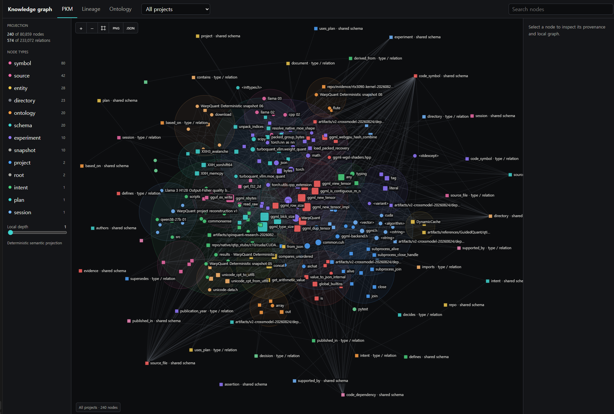
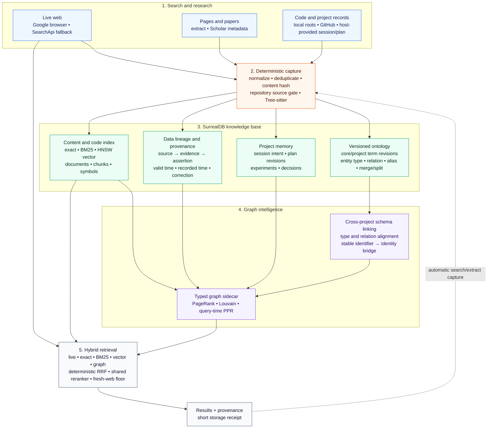
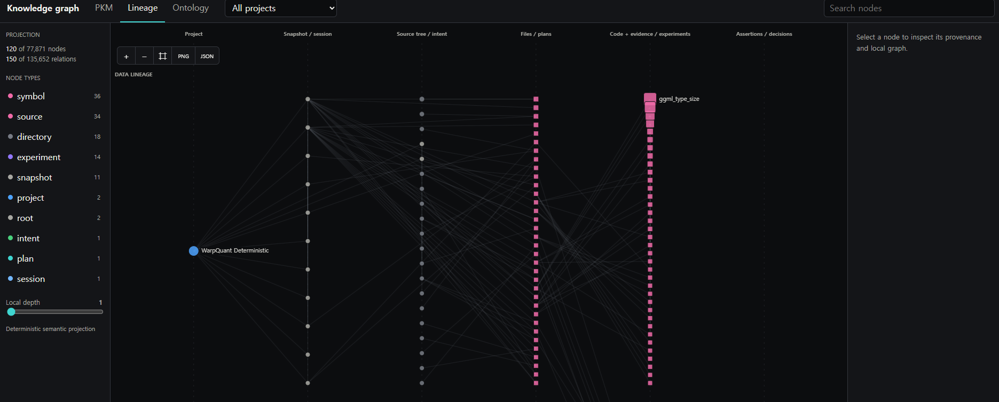
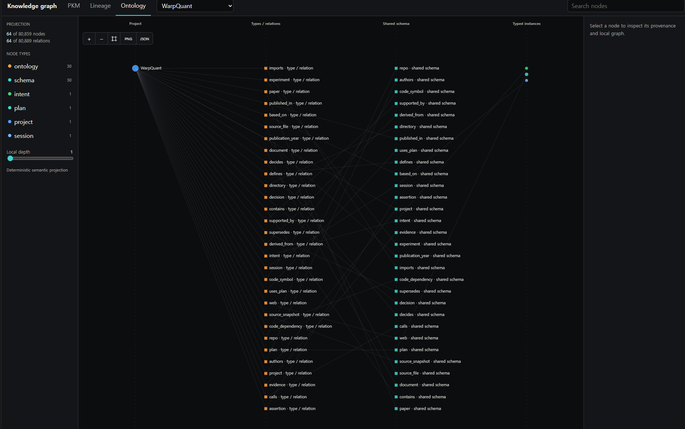

# Google Surf Auto Ontology

Local knowledge storage, durable indexing, ontology, lineage, graph retrieval, and export.

[Back to README](../README.md) | [Tools](tools.md) | [Configuration](configuration.md) | [Operations](operations.md) | [Benchmarks](benchmarks.md)

<a href="../assets/graph-pkm.png"></a>

> Web searches, papers, and GitHub repositories are stored as PKM, ontology, and lineage. The view above is generated with `project_memory(action="export", export_format="html", export_view="graph", all_projects=true)`.

*"Turn Google Search, Papers, and Codebases into an Automatic Local Knowledge Graph and lineage for AI Agents with Zero API Key, Zero External Server."*

Google Surf Auto Ontology stores search and extraction results in a project-scoped local knowledge graph.

As you search, papers, code, web sources, session intent, plans, experiments, and decisions accumulate in a personal PKM. New research searches stored knowledge and fresh web results together, reducing repeated work while continuing to discover new information.

Projects remain isolated by default. Only verifiable links such as matching DOIs, repository URLs, or explicit aliases are added, so knowledge from one project can be reused in another without merging the original records.

Retrieval runs exact search, BM25, vector search, code and graph search, and live web independently, then combines them with RRF and one shared reranker.

```text
Live web + Papers + Codebases + Project memory
                        ↓
Exact + BM25 + Vector + Code graph + Graph PPR
                        ↓
              RRF + Shared reranker
                        ↓
        Results with evidence and provenance
```

Seven tools are available by default: `search` / `search_parallel` / `extract` / `scholar_search` / `project_memory_search` / `project_memory` / `health`.

Auto Ontology and automatic capture are enabled by default. Set `SURF_RESEARCH=false` to use search and extraction without opening the database or graph sidecar; the project memory tools are not registered in that mode. Auto Ontology is the new name for research mode; existing `SURF_RESEARCH*` settings, storage paths, CLI commands, and `project_memory*` tool names remain unchanged.

With Auto Ontology disabled, live `search` and `search_parallel` results still use a lightweight in-memory reranker. It fuses the provider order with query BM25 rank through RRF without loading the vector model or opening local storage.

Browser search needs no API key. SearchApi can be configured as an optional primary provider or fallback.

## Core features

- **Web, paper, and codebase search:** Google web search is the default, while Scholar is used for paper-specific metadata. SearchApi can act as an optional primary provider or fallback.
- **Web and academic document extraction:** HTML and PDF extraction returns available titles, authors, DOIs, publication metadata, and body text. `search` and `search_parallel` can include abstracts or full bodies.
- **Automatic project memory:** Search results, extracted bodies, and code repositories are stored in the current project. Unread results remain metadata; extracted content becomes active RAG evidence.
- **Structured codebase search:** Tree-sitter links files, symbols, imports, and calls from local projects and relevant GitHub repositories. Exact, BM25, vector, and graph search retrieve the code.
- **Graph hybrid retrieval:** Fresh web results, papers, stored content, codebases, and the project graph are searched independently. Exact, BM25, vector, and PPR candidates are combined through RRF and one shared reranker.
- **Ontology and data lineage:** Web sources, papers, code, plans, experiments, and decisions become typed entities and relations. Evidence paths run from source through documents, chunks, symbols, evidence, and assertions.
- **Cross-project knowledge reuse:** Projects remain isolated but selected projects can be searched together. Only verifiable links connect matching entities.
- **Durable research history:** Session intent, plans, experiments, failures, and decisions supplied by the MCP host are stored as revisions and linked to their supporting evidence.
- **Local graph analysis and export:** PageRank, PPR, connected components, and Louvain communities run without a separate Neo4j server. Results export to HTML, Graphviz, D3 JSON, and Neo4j import formats.

## Capture and retrieval architecture



## One local knowledge base

One SurrealDB instance is the authority for three distinct layers:

- **Catalog:** stable identities, revisions, project membership, ontology, provenance, and temporal links.
- **Payloads:** exact bodies, source snapshots, manifests, and artifact references. Identical content is stored once and can be fetched by ID and byte span.
- **Derived views:** exact, BM25, vector, code, and graph indexes plus the compact current-project view. These are versioned by source hash and can be rebuilt.

A single local Auto Ontology broker owns the embedded RocksDB connection. Multiple MCP sessions connect through authenticated local IPC, run bounded reads concurrently, and serialize writes without opening another database process. Original evidence and historical occurrences remain addressable even when bodies, embeddings, or graph structures are deduplicated.

## Durable records and incremental indexing

`project_memory` writes project profiles, plans, experiments, attempts, measurements, artifacts, documents, decisions, and sessions as typed records. A stable asset ID receives revisions; an uncertain retry with the same idempotency key returns the committed revision with `idempotent_replay=true` and `applied_this_request=false`. `body_path` streams bodies up to 256 MiB, artifact manifests are paginated instead of sliced, and `get`/`get_batch` return exact typed or legacy records through bounded body spans. Compact write receipts report accepted bytes, references, revision, and the exact readback handle without echoing the submitted body.

`sync` accepts registered roots or explicit changed and removed paths. Unchanged roots and parent identities remain intact, a no-op does not rewrite derived indexes, and a one-file change publishes only the affected generation. Code, retrieval, and graph publication run under one durable job ID. `job_wait` uses a revision cursor, `job_cancel` stops at a safe stage boundary, and unfinished jobs resume after process restart. Under the worker soft-memory limit, foreground requests finish first; rebuildable index jobs checkpoint at a durable stage boundary and resume in the replacement worker without cancelling the committed record.

## Ontology and cross-project links

Ontology records can include `definition`, project-owned `evidence_ids`, and `review_status` (`draft` by default). Mark a definition `reviewed` only after explicit host review; the server requires its definition and evidence but cannot independently certify its truth. Use `supersedes_term_id` for a changed definition or review. Project-aware web searches return up to six matching active terms in `research_context.ontology_terms`, with bounded definitions, aliases, evidence IDs, scope, and version. Unreviewed and legacy terms remain distinguishable from reviewed definitions; unrelated projects are not included.

The versioned ontology preserves entity type and relation changes as revisions. Schema linking aligns project-specific types and relations with the shared schema. Entity linking connects the same paper, repository, or entity only when verifiable identifiers such as a DOI, repository URL, or explicit alias match. Ambiguous candidates are not linked automatically.

## Data and research lineage

- **Source lineage:** `source → document → chunk → evidence → assertion`
- **Code lineage:** `repository → directory → file → symbol → import/call`
- **Research lineage:** `session → intent → plan revision → experiment → decision`

This preserves the evidence behind claims and decisions while retaining corrected or superseded history.

## Graph retrieval

Graphology builds a typed graph projection from SurrealDB and computes PageRank, connected components, and Louvain communities. At retrieval time, related nodes seed PPR-based multi-hop search. Live web, exact, BM25, vector, and graph candidates are combined through deterministic RRF and one shared reranker.

Local multi-query retrieval batches query embeddings, keeps exact, BM25, and vector lanes independent through RRF, expands the graph once, hydrates selected chunks once, and reranks once. Graph-only all-project searches use a lightweight memory-node index and verified identity aliases to select at most four graph scopes instead of constructing every project graph at query time.

Project lanes read at most two scopes concurrently. Code BM25 rank metadata is shared within each query, then only selected project-owned bodies are hydrated. Scopes with up to 1,024 active-model vectors use exact cosine ranking over all their vectors; larger scopes use HNSW. The requested search scope, model and index format are unchanged.

If query embedding fails or returns no vector, local search returns its lexical/graph ranking without retrying the model in reranking. Timing fields are non-overlapping wall-clock partitions: `embedding_ms` plus `retrieval_ms` reaches the end of retrieval, and `rerank_ms` covers the remaining response work. Retrieval may overlap embedding, so `retrieval_ms` is not standalone database execution time. A supplied `response_deadline_ms` starts after broker admission; the transport watchdog retains its five-minute queue/IPC allowance in addition to that deadline. Native queries that outlive a partial response retain their broker read slot until they settle.

Recorded retrieval and broker checks are in [benchmarks](benchmarks.md#auto-ontology-retrieval-check). Storage controls and local CLI commands are in [operations](operations.md#storage-scope-and-security).

## Project isolation and knowledge reuse

`project_id` selects where new results are stored. `include_project_ids` expands the read scope without changing the write target. Original records remain isolated by project, while verified schema and entity links allow papers, code, and experiment results to be reused across selected projects.

## Interactive graph and export

Use `project_memory(action="export", export_format="html", export_view="graph")`. The returned standalone HTML opens locally without a server and contains three coordinated views. Use `project_id` for one project, `include_project_ids` for a selected combined graph, or `all_projects=true` for every project.

- **PKM** groups the integrated project graph by community and sizes nodes by PageRank.
- **Lineage** separates source and code lineage from session, intent, plan, experiment, and decision lineage while keeping both flows aligned by stage.
- **Ontology** shows core types and relations, aligned shared schema, and typed instances. A verified identity layer appears only when stable identifiers or explicit aliases prove a cross-project match.

<table>
  <tr>
    <td width="50%" align="center">
      <a href="../assets/graph-lineage.png"></a><br />
      <strong>Data and research lineage</strong>
    </td>
    <td width="50%" align="center">
      <a href="../assets/graph-ontology.png"></a><br />
      <strong>Ontology and shared schema</strong>
    </td>
  </tr>
</table>

Search, type filters, one to three hop local focus, pan, zoom, and the provenance inspector work inside the file. Large graphs use a deterministic semantic projection that balances node type, PageRank, degree, and community coverage. The viewer reports source and displayed counts, replaces internal IDs with local aliases, disambiguates repeated labels, and does not embed source IDs, local paths, node bodies, plan text, or evidence quotes.

The project menu switches between every project embedded in the export and an integrated `All projects` view. Use `all_projects=true` when exporting to include every named project in the local database, or use `project_id` and `include_project_ids` for a bounded set. Clicking empty canvas space clears local node focus. PNG exports the current canvas, while JSON exports the current tab, project, type filters, and local focus using only the anonymized viewer payload. The standalone file has a nonce-bound script CSP, makes no network connections, and permits source links only for stripped public HTTP or HTTPS URLs.

### Neo4j export

Use `project_memory(action="export", export_format="neo4j", export_view="graph")`. The returned directory contains `nodes.csv`, `relationships.csv`, `constraints.cypher`, `load.cypher`, `manifest.json`, and `README.txt`. PageRank, community, ontology, lineage, project IDs, source IDs, and evidence IDs are preserved. Node bodies, plan text, and evidence quotes are not exported.

For a new or empty local database, run the Neo4j offline importer from the export directory:

```powershell
neo4j-admin database import full --nodes=nodes.csv --relationships=relationships.csv neo4j
```

For an existing local database, copy both CSV files to the Neo4j import directory, then run:

```powershell
cypher-shell -f constraints.cypher
cypher-shell -f load.cypher
```

The offline importer creates typed node labels and relationship types. The online loader uses `SurfNode` and `SURF_RELATION`, retaining the original kinds and relationship types as properties. `neo4j-admin database import full` is intended for a new or empty database; use `LOAD CSV` for an existing database. See the official [Neo4j import](https://neo4j.com/docs/operations-manual/current/import/) and [LOAD CSV](https://neo4j.com/docs/cypher-manual/current/clauses/load-csv/) documentation. Bolt is a connection protocol, not an export file format, so this command does not connect to or modify a Neo4j server.

## Tech Stack

- **Runtime:** Node.js, TypeScript, Model Context Protocol SDK
- **Web search:** System Chrome + CDP, Playwright compatibility fallback, SearchApi fallback
- **Web extraction:** Mozilla Readability, Turndown
- **PDF extraction:** LiteParse/PDFium, optional OCR, `pdf-lib` metadata parsing
- **Code collection:** Local project roots and gated GitHub sparse download
- **Code parsing:** Tree-sitter for files, symbols, imports, and call relations
- **Code search:** Exact lookup, BM25, Multilingual E5 vector search, and graph PPR
- **Local database:** Embedded SurrealDB on RocksDB
- **Hybrid retrieval:** Live web, papers, project memory, and codebase results combined through RRF
- **Ranking:** Reciprocal Rank Fusion and shared vector reranking
- **Graph analysis:** Graphology, PageRank, PPR, connected components, and Louvain communities
- **Knowledge model:** Versioned ontology, data lineage, cross-project schema and entity linking
- **Recovery:** CAPTCHA recovery, Playwright pool fallback, and deterministic parser self-healing
